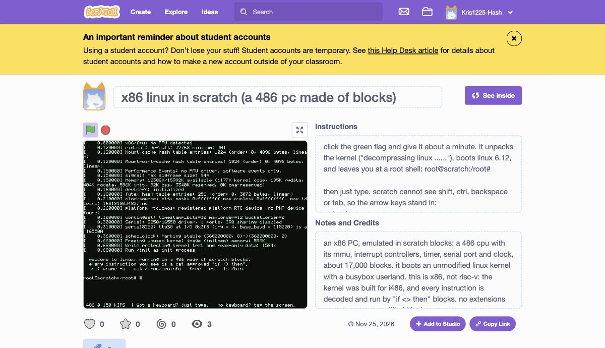
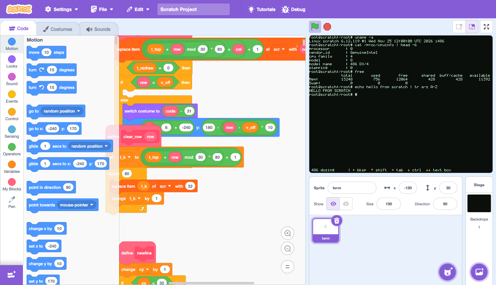

# scratch-linux

an x86 pc made of scratch blocks, booting real mainline linux to a shell. yes, the scratch for kids. (x86, not
risc-v: that one had been done.)

**run it: [scratch.mit.edu/projects/1444498783](https://scratch.mit.edu/projects/1444498783)** — green flag, about
a minute, root shell. the same project in turbowarp gets there in four seconds:
[turbowarp.org/1444498783](https://turbowarp.org/1444498783).



the project is one `.sb3` file: 17,000 to 18,000 blocks that implement an i486 cpu, its mmu, the interrupt
controllers, a timer, a serial port and a clock, plus a terminal drawn with the pen. the kernel (linux 6.12.119,
unmodified) and a busybox userland are data inside it. press the green flag and a while later you are looking at
`root@scratch:/root#`. no extensions (other than pen), no modified vm: it runs in the stock scratch 3 editor.

it comes in two builds of the same emulator:

| | `out/linux.sb3` | `out/linux-site.sb3` (`--site`) |
|---|---|---|
| project.json | 40 MB | 4.6 MB |
| where it runs | scratch editor, loaded from a file | that, and scratch.mit.edu (which refuses to save more than 5 MB) |
| flag to shell | 25 to 30 s | about a minute |
| how | ram and tables are big lists in the file, the kernel arrives decoded | every big list is built at power-on, the kernel is unpacked from text ([below](#the-5-mb-version)) |

nothing compiled is in this repo. it holds the sources, the configs and the build scripts; you build your own
kernel and your own `.sb3`, and the build is the proof.

## build it

you need node (i used 26, anything recent should do) and, for the kernel, either docker or a debian / ubuntu
machine.

```
npm install
./build/docker.sh                  # cross toolchain, busybox, /init, kernel -> out/kernel/vmlinux   (15 to 20 minutes the first time)
node tools/build_sb3.js            # -> out/linux.sb3
node tools/build_sb3.js --site     # -> out/linux-site.sb3, the one that fits scratch.mit.edu
```

`build/docker.sh` runs `build/build.sh` in an ubuntu container; on a linux box you can run `build/build.sh`
directly (`--install-deps` apt-installs what it needs). it builds an i486 musl cross compiler with
musl-cross-make, a static busybox, a tiny `/init`, and linux from the `v6.12.119` tag with
`tinyconfig` + [`build/kernel.frag`](build/kernel.frag), root filesystem linked in as an initramfs. versions and
hashes are pinned in the script.

## run it

- **on scratch.mit.edu:** the link at the top. or your own: *create*, *file → load from your computer*, pick
  `out/linux-site.sb3`, and it saves like any other project (save it before the first green flag, or see the note
  on saving below).
- **in the scratch editor, from a file:** *file → load from your computer*, pick `out/linux.sb3` (the fast build;
  scratch.mit.edu will run it but cannot save it), green flag.
- **in the scratch editor on your own machine:** `(cd tools/gui && npm install)` once, then `npm run gui` and open
  `http://127.0.0.1:8601/?go` (`?site&go` for the site build). that is the unmodified `@scratch/scratch-gui` bundle
  with the project loaded.

  
- **without a browser:** `node tools/run_sb3.js --keys 'uname -a\n'` boots the `.sb3` in the stock `scratch-vm`
  under node, presses keys, and prints the screen.
- **without scratch:** `node tools/run.js --input 'uname -a\n'` runs the same emulator source compiled to
  javascript (50 to 100 times faster; this is where the debugging happens).

### keyboard

scratch can tell which key went down and nothing else: no shift, no ctrl, no backspace, no tab. so:

| key | does |
|---|---|
| letters, digits, symbols, space, enter | what they say (every key has its own "when key pressed" hat) |
| ← | backspace |
| ↑ | shift for the next letter. twice: caps lock |
| → | tab |
| ↓ | ctrl for the next key (↓ then c = ctrl-c) |
| ↓ ↓ | open scratch's text box, to send a whole line at once (or paste) |

no keyboard (phone, tablet)? tap the screen. a tap before any key press switches to touch mode, where the text
box stays up and the screen scrolls so the prompt is not hidden behind it.

## what is emulated

- **cpu:** an i486SX. protected mode, paging with accessed / dirty bits and write protect, kernel and user
  mode with the stack switches between them, flat segments plus fs / gs bases, faults that restart instructions
  properly.
  no fpu: the kernel's own math emulation handles x87 (so `awk` does floating point; slowly).
- **devices:** 8259 interrupt controllers, 8254 timer, 16550 serial port (the console), cmos clock (reads
  scratch's "current year / month / ..." blocks).
- **memory:** 16 MB, as one list of 32-bit words.
- **boot:** there is no bios. the build unpacks `vmlinux` into the memory image, writes the boot parameters the
  kernel expects from a bootloader, and the cpu starts at the kernel's 32-bit entry point.

not there: disks, network, graphics, sound, a second cpu, 16-bit real mode, vm86.

## how it works

**sbl.** nobody is dragging 18,000 blocks around by hand. [`sbl/`](sbl) is a small language (c-like syntax, scratch
semantics: global variables, lists, custom blocks, no return values, no bit operations) with two backends: one
writes scratch blocks into an `.sb3`, the other writes javascript. the emulator in [`emu/`](emu) is written in it
once, so the thing that is debugged under node is block for block the thing that runs in scratch.
`test/sbl_basic.js` checks the two backends against each other in the real scratch vm.

```
proc tlb_invlpg(lin) {
  tf_vp = floor(lin / 4096);
  tlbR[tf_vp + 1] = 0; tlbR[tf_vp + 1 + TLB_HALF] = 0;
  ...
}
```

**no bit operations.** scratch has `+ - * / mod floor` on doubles and that is it. and / or / xor go through a
65,536-entry table of byte ands (`or = a + b - and`, `xor = a + b - 2 * and`), shifts are multiplications and
divisions by a table of powers of two, and flags are computed lazily from the last result so that most
instructions never pay for them.

**decode once.** x86 is decoded into "trace" lists (handler number + up to six operands) the first time a piece
of code runs, in blocks that chain to each other. running an instruction is then: fetch the handler number, walk
an if / else tree to the handler, run it. the tree is a huffman tree built from a profile, so the common
instructions sit a few comparisons from the top. writes into pages that hold decoded code are noticed through
the tlb and throw the stale blocks away (linux patches its own text while booting).

**the tricks that paid for themselves**, measured in the stock scratch vm:

- the block cache starts out full: the build boots the kernel once on the javascript build and stores what the
  decoder produced in the project. at run time a pre-decoded block is used only if the memory it was decoded from
  still holds the same words.
- a software tlb (two lists, one entry per page and privilege level) turns a memory access into two list reads.
- a "stack window": push, pop, call, ret and `[esp + n]` go straight to the memory word under the stack pointer
  as long as the stack stays inside a page it may write.
- the kernel is configured for the machine it is on: every instruction costs ~50 blocks, so the crypto self
  tests, stack zeroing and friends had to go ([`build/kernel.frag`](build/kernel.frag)).
- an idle machine dozes: after five seconds with nothing to do, the clock runs slow so the 100 Hz timer
  interrupt is not what the cat spends its life on.

## the 5 MB version

scratch.mit.edu will not save a project whose `project.json` is over 5 MB. the fast build is 40 MB: 16 MB of ram
as a list of zeros, a tlb with an entry per page, the kernel as a list of numbers, the decoder's output. and
there is a second wall: a list that is built by blocks stops growing at 200,000 items. so "just create the zeros
when the flag is clicked" is not an option for a 4-million-word ram. `--site` gets it to 4.6 MB like this:

- **paged memory** ([`emu/mem.js`](emu/mem.js)). ram lives in 22 "cold" lists of 195 pages each, and the cpu
  works on one "hot" list of 195 page frames. the tlb hands out addresses inside the frames, so the handlers'
  fast paths are the ones of the fast build; a page that is not in a frame gets copied in, clock-fashion, and a
  dirty one copied back out. linux touches about 870 different pages during a boot, in bursts: ~2,700 page-ins
  for the whole boot, a few percent of the time.
- **a two-level tlb** for the same reason: tables of 1024 entries, handed out as 4 MB stretches of address space
  get used.
- **the kernel as text** ([`tools/zpack.js`](tools/zpack.js), [`emu/unpack.js`](emu/unpack.js)). LZ77 plus an
  rANS coder with static tables, its output written in base 93: every printable ascii character except the two
  json would escape. 2.47 MB of memory image become 1.46 MB of project file, and the project unpacks it at
  power-on, printing `decompressing linux ......` while it does, the way a pc would. scratch has no character
  codes, so each digit is read by "switch costume to (letter)" on the terminal sprite, whose costumes happen to
  be the printable characters.
- **compact handlers.** two thirds of the instruction handlers together run 3% of the instructions. those call
  procs for memory access instead of carrying the inline fast paths: 2,800 blocks less for 0.4% of the speed.
- **no decoded kernel in the file.** the fast build's block cache starts out full; this one decodes as it goes.

saving it: while it runs, its lists hold the 16 MB of ram, and scratch cannot save that either. the first script
on the stage ("click me before saving") empties them.

**the tricks that did not** are still in the tree, switched off, with the measurements that killed them:
fusing common instruction sequences into single handlers (`tools/mkfuse.js`, `--fuse`) removes 38% of the
dispatches and makes the project *slower*, because the stock interpreter gets slower per block the more distinct
blocks a hot loop touches (`test/bench_locality.js` shows the effect in isolation).

## how it is checked

- **against qemu, instruction by instruction.** `tools/lockstep.js` runs real qemu next to the javascript build,
  feeds the emulator qemu's device reads and interrupts, and compares every register, the flags, the control
  registers and the segment state after every single instruction. the boot and a scripted shell session, 14
  million instructions, and an interactive session with floating point through the kernel's x87 emulation,
  another 42 million, run without a single difference. (it found about ten real bugs on the way there, down to
  "the accessed bit of a page directory entry is set even when the walk then faults".)
- **against itself.** `tools/diffrun.js` runs the plain interpreter next to the configuration that ships (seeded
  block cache), comparing the cpu after every instruction and all of memory at the end. `--site` does the same
  for the emulator of the 5 MB build (paged memory, compact handlers): 32 million instructions, no difference.
- **in scratch.** `tools/run_sb3.js` boots the actual `.sb3` in the unmodified `scratch-vm` package and types at
  it; `tools/gui` puts it in the unmodified scratch editor. the site build was booted on scratch.mit.edu itself.

`npm test` runs the quick ones. the kernel itself is the best test there is: it does not boot on a cpu that is
almost right.

## how fast

the boot is 8.5 million instructions. the stock scratch interpreter runs a block in 50 to 100 ns, an emulated
instruction is ~47 blocks, half of them spent finding the handler. on a recent laptop that makes 250,000 to
300,000 instructions per second: about 25 seconds to the prompt under node, about 30 in the browser.
`uname -a` takes two or three seconds. it is a 486 running at the speed of an 8088, which feels about right.

the site build takes about a minute: ten seconds of building lists and unpacking, then a boot that is slower
because nothing is decoded in advance (+20%) and memory is paged (+10%).

turbowarp compiles scratch to javascript and runs either build at 4 to 5 million instructions per second.

## what is where

```
sbl/      the language: parser, scratch (.sb3) backend, javascript backend, headless scratch-vm runner
emu/      the machine, in sbl: cpu core, handlers, decoder, system instructions, devices, terminal + keyboard,
          the two memory models (mem.js), the unpacker of the site build (unpack.js)
build/    kernel config fragment, busybox config, /init, the scripts that build them
tools/    build_sb3 (the project), zpack (the kernel as text), run / run_sb3 (boot it), lockstep / diffrun
          (check it), profilers, gui
test/     compiler tests and interpreter benchmarks
```

## license

MIT for what is in this repository. linux and busybox are GPL-2.0; they are not in here, the build scripts fetch
their sources. a built `.sb3` contains both, so if you pass one on, pass on where it came from too.
